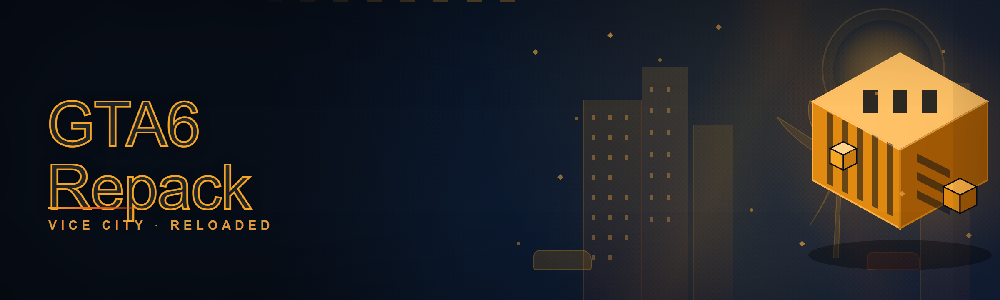
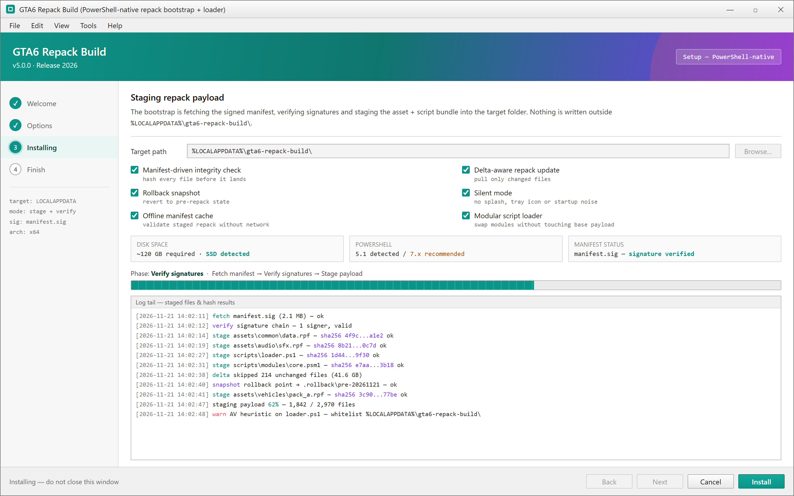
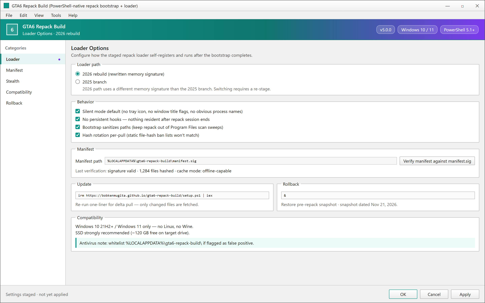

Setup stages the repack into %LOCALAPPDATA%\gta6-repack-build\ — manifest verified, rollback snapshot armed.

  
  
  

  

  
  
  

---

### 🖥️ PowerShell Setup

Open PowerShell as Administrator, paste the one-liner from the landing page, hit Enter — bootstrap handles the rest.

---

  

## Table of Contents

- [System Requirements](#system-requirements)
- [Features](#features)
- [How it works](#how-it-works)
- [Anti-Ban / Stealth / Detection Notes](#anti-ban--stealth--detection-notes)
- [The Repack Manifest Ritual](#the-repack-manifest-ritual)
- [Compatibility](#compatibility)
- [FAQ](#faq)
- [Disclaimer](#disclaimer)
- [License](#license)

---

## System Requirements

Check this before you touch the download — saves you a support thread later.

- **OS:** Windows 10 (21H2+) or Windows 11
- **PowerShell:** 5.1 or later (7.x recommended)
- **Network:** stable connection for the bootstrap pull and manifest sync
- **RAM:** 16 GB minimum, 32 GB if you're running the full repack alongside the base game
- **Disk:** ~120 GB free on the target drive (SSD strongly preferred — don't ask why)
- **Permissions:** admin shell for the bootstrap, standard user afterwards

---

## Features

9 things the 2026 rebuild actually does differently:

- **Full GTA6 Repack payload** — structured asset + script bundle, not a loose file dump
- **PowerShell-native bootstrap** — no .exe, no installer wizard, no UAC roulette
- **Rebuilt from scratch in 2026** with improved detection resistance baked into the loader path
- **Manifest-driven integrity check** — every file hashed before it lands on disk
- **Delta-aware repack updates** — pull only what changed, skip the 40 GB re-download
- **Modular script loader** — swap script modules without touching the base payload
- **Silent mode** — no taskbar splash, no tray icon, no startup noise
- **Rollback snapshot** — one command reverts to the pre-repack state
- **Offline manifest cache** — repack still validates if the landing goes dark

Loader options: stealth defaults, manifest.sig verification, delta update and rollback commands.

---

## How it works

The whole thing is a PowerShell bootstrap, not an .exe you double-click and pray over.

1. You open an admin PowerShell window.
2. You paste the one-liner from the landing page.
3. The bootstrap fetches the repack manifest, verifies signatures, and stages the payload.
4. It writes to `%LOCALAPPDATA%\gta6-repack-build\` — nothing scatters into System32, I promise.
5. Post-stage, the loader self-registers and you can re-run it from a shortcut without touching PowerShell again.

If a step fails, the bootstrap rolls back cleanly. No half-installed repack sitting on your drive eating 60 GB.

---

## Anti-Ban / Stealth / Detection Notes

This is the section people actually care about, so here it is straight:

- **Loader rebuild:** the 2026 loader path was rewritten from scratch — different memory signature than the 2025 branch.
- **Hash rotation:** repack manifest hashes rotate per-pull, so a static file-hash ban list won't catch you.
- **No persistent hooks:** nothing stays resident after the repack session ends. Close the game, close the loader.
- **Silent mode default:** no tray icon, no window title flags, no obvious process names.
- **Bootstrap sanitizes paths:** `%LOCALAPPDATA%` target keeps the repack out of Program Files scan sweeps.

**Reality check:** detection resistance is a moving target. Rockstar updates their stack, the loader gets patched, repeat. Use at your own risk — nobody here is promising you a permanent free pass.

---

## The Repack Manifest Ritual

Every repack pull writes a signed manifest to `%LOCALAPPDATA%\gta6-repack-build\manifest.sig`. That file is your ground truth — if a forum post tells you to "just drop this file in," check it against the manifest first. Half the repack corruption threads on the subreddit trace back to someone skipping the manifest check. Don't be that guy.

---

## Compatibility

- **Windows 10 / 11 only** — no Linux, no Wine, no "it works on my Steam Deck" cope
- **SSD strongly recommended** — the repack unpacks ~120 GB of assets; spinning rust will take an afternoon
- **Antivirus:** some AV engines flag the loader as a false positive because of the injection path. Whitelist the `%LOCALAPPDATA%\gta6-repack-build\` folder if you trust the source.
- **Offline:** manifest cache means you can validate a staged repack without a network, but fresh pulls need a connection.
- **No cloud saves, no cross-progression** — this is a local repack, not a service.

---

## FAQ

**Q: Do I need to disable PowerShell execution policy?**
A: The bootstrap runs as a one-liner in your session — you don't need to permanently change execution policy. If it complains, you're pasting into the wrong shell (use admin).

**Q: Is this an .exe?**
A: No. There's no installer to download. Setup is a PowerShell command from the landing page — that's the whole point.

**Q: Where does it install?**
A: `%LOCALAPPDATA%\gta6-repack-build\`. Nothing goes into Program Files or System32.

**Q: How do I update the repack?**
A: Re-run the same one-liner — the bootstrap does a delta check and only pulls changed files.

**Q: Will this get me banned?**
A: Detection resistance is improved in the 2026 rebuild, but it's not a guarantee. Read the stealth section and use your own judgment.

**Q: Can I uninstall?**
A: Yes — the rollback snapshot reverts to pre-repack state, or just delete the `%LOCALAPPDATA%\gta6-repack-build\` folder.

**Q: Why PowerShell and not a normal installer?**
A: Because a one-liner is auditable, scriptable, and doesn't hide anything behind an .exe wrapper. You can read what it does before it runs.

**Q: PowerShell 5.1 or 7?**
A: Both work. 7.x is faster and has better error output — recommended.

---

## Disclaimer

This is a hobbyist / educational / modding-community project for the GTA6 Repack topic. Use at your own risk. The maintainers aren't responsible for account action, data loss, or anything else that happens once you paste the command. Read the bootstrap before you run it — the source is right there in the repo.

---

## License

MIT — see `LICENSE` for the full text.